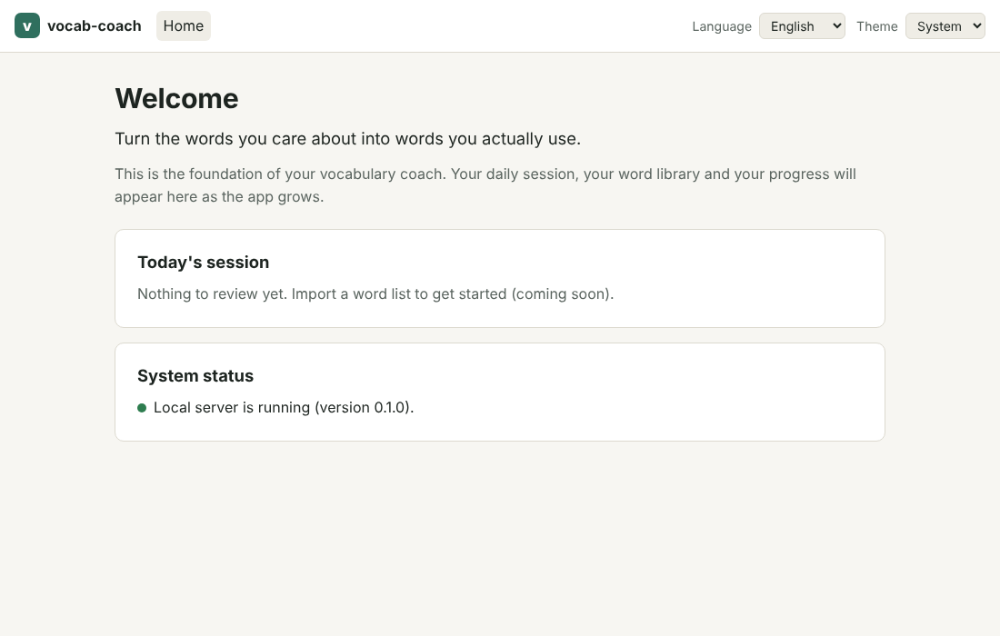

# vocab-coach

**Turn the words you care about into words you actually use.**

vocab-coach is a free, local web app for French-speaking learners of English. You bring the words and
expressions you meet in your reading, classes or daily life; the app builds a usage sheet for each one,
walks you through a first discovery, schedules spaced reviews (FSRS), makes you produce sentences and speak,
logs your recurring errors (prepositions, tenses…) and shows your progress with real statistics.

> **Status: milestone M2.b2 (AI providers).** The app starts and shows an empty home screen. Behind it
> sit the data model, the review scheduler, demo data and an AI gateway with Gemini, Groq and Ollama
> adapters, usable from the command line (`python -m app ai ...`). Screens arrive milestone
> by milestone — see [`docs/PROGRESS.md`](docs/PROGRESS.md) and the roadmap in
> [`docs/SPEC.md`](docs/SPEC.md#9-roadmap).



## Principles

- Active recall before any answer is shown; spaced repetition with FSRS.
- Words, collocations and spoken formulas learned in real context, with pitfalls for French speakers.
- Production first: sentences, paragraphs and speaking, with corrections that feed an error log.
- Free to run: only free AI tiers (Gemini, Groq, local Ollama) and the browser's speech synthesis.
  Works without any key in a degraded mode.
- Private: everything stays on your computer. Your data is never committed to the repository.

## Install on Windows 11

You need **Git**, **uv** and **Node.js LTS (≥ 22.22)**. Python is installed for you by uv.

1. Open **PowerShell** and install what is missing (skip what you already have):

   ```powershell
   winget install --id Git.Git -e
   winget install --id astral-sh.uv -e
   winget install --id OpenJS.NodeJS.LTS -e
   ```

   Close and reopen PowerShell afterwards so the new commands are found.

2. Get the code:

   ```powershell
   git clone https://github.com/<your-account>/vocab-coach.git
   cd vocab-coach
   ```

3. Check your environment (it tells you exactly what to install if something is missing):

   ```powershell
   powershell -ExecutionPolicy Bypass -File .\scripts\check-env.ps1
   ```

4. Start the app:

   ```powershell
   .\start.cmd
   ```

   or double-click `start.cmd` in File Explorer. The first run installs the dependencies (a few minutes),
   then your browser opens on <http://127.0.0.1:5173> as soon as the app answers. Press **Ctrl+C** in
   the terminal to stop. Add `-NoBrowser` to start without opening the browser.

   If you prefer PowerShell directly: `.\start.ps1` (if scripts are blocked, use
   `powershell -ExecutionPolicy Bypass -File .\start.ps1`).

### macOS / Linux

Install Git, [uv](https://docs.astral.sh/uv/getting-started/installation/) and Node.js LTS, then:

```bash
git clone https://github.com/<your-account>/vocab-coach.git
cd vocab-coach
./start.sh
```

## Try the demo

To see the app with about two months of fictional history (decks, reviews, productions and errors)
without touching your own data:

```powershell
.\start.cmd -Demo
```

(`./start.sh --demo` on macOS / Linux.) The first demo launch generates `data/vocab-coach-demo.sqlite3`
in a few seconds and prints a summary; the top bar then shows a **Demo data** badge. Your own database
(`data/vocab-coach.sqlite3`) is never read or changed in demo mode. Start without `-Demo` to get back
to it.

Other demo commands (run from `backend/`):

| Command | What it does |
|---|---|
| `uv run python -m app --demo plan today` | Today's session plan on the demo database |
| `uv run python -m app demo seed --reset` | Rebuild the demo database (stop the app first) |
| `uv run python -m app demo seed --seed 7 --days 30 --reset` | Another reproducible history |

The same seed always produces the same data. Everything in the demo (`content/demo/`) is invented.

## Configuration

Copy `.env.example` to `.env` (same folder) and fill in what you need. `.env` is ignored by Git, so your
keys never reach the repository. Every variable is optional: without any key the app still starts and
runs in a degraded mode (no AI features).

The AI keys can also be added, replaced and removed from the application itself: open **Settings** in the
top bar. The page writes the three AI variables into `.env` for you (it keeps your comments and other
lines), never shows a saved key again, and has a **Test connection** button per provider (one real request,
up to about a minute and a half). The same page sets the provider order, shows today's AI calls and holds
the study settings (time budget, new terms per day, target retention, study day, audio speed). Editing `.env` by hand stays possible. If one of these variables is **also set
as an environment variable**, the environment wins and the application will not edit that key (remove the
environment variable first).

> **Privacy.** Whatever the app sends to an AI provider leaves your computer. Send nothing confidential.
> On the **free tier of Gemini**, Google's pricing page says the content *may be used to improve its
> products* (it is not on the paid tier). Your words, sentences and corrections are sent to Gemini first
> (it is the first provider tried): if that matters to you, leave the Gemini key empty and the app uses
> Groq or Ollama only.

### Gemini: the main free text model (Google AI Studio)

1. Sign in at <https://aistudio.google.com/apikey> with a Google account and create an API key (Google may ask
   you to accept its terms; check there whether your account and country get the free tier).
2. In `.env`, add `VOCAB_GEMINI_API_KEY=` followed by the key: no quotes, no spaces.
3. Check it from the `backend` folder:

   ```powershell
   cd backend
   uv run python -m app ai test --provider gemini
   ```

   You should see a line like `gemini: ok (gemini-3.5-flash-lite, 700 ms, tokens in/out 88/11)`.

- **Model**: `gemini-3.5-flash-lite` by default (a stable model, free of charge according to
  [Google's pricing page](https://ai.google.dev/gemini-api/docs/pricing), read on 2026-10-16). To use
  another one, set `VOCAB_GEMINI_MODEL` (for instance `gemini-3.8-flash`); leave it empty for the default.
  Some models have no free tier (`gemini-4-argon`, per Google's pricing page): with a free key, a call to one of them is refused.
- **Limits**: Google does not publish the free-tier numbers; they are per project and shown in
  [AI Studio](https://aistudio.google.com/). A per-minute limit is waited for (up to 20 seconds) or the app
  moves on to Groq; a daily limit sets Gemini aside for an hour (the quota resets at midnight Pacific time).
- **Availability**: Cameroon is in Google's list of supported countries. Whether the free tier works for
  your key from there is only confirmed by a real call: if `ai test` reports `auth` with a message about
  the region or the free tier, the app keeps working with Groq and Ollama.

### Groq: free text model and speech-to-text

1. Create an API key at <https://console.groq.com/keys> (sign in or create an account if the console asks).
2. In `.env`, add `VOCAB_GROQ_API_KEY=` followed by the key: no quotes, no spaces.
3. Check it from the `backend` folder:

   ```powershell
   cd backend
   uv run python -m app ai status
   uv run python -m app ai test
   ```

   You should see a line like `groq: ok (openai/gpt-oss-20b, 650 ms, tokens in/out 96/14)`.

The free plan has limits. Approximate values from [Groq's rate-limits page](https://console.groq.com/docs/rate-limits)
(read on 2026-10-16, checked again on 2026-10-18; they change, and your own limits are shown in your Groq console):

| Model used by default | Requests | Tokens / audio | Notes |
|---|---|---|---|
| `openai/gpt-oss-20b` (text) | 30 per minute, 1,000 per day | 8,000 tokens per minute, 200,000 per day | the app falls back or waits when a limit is hit |
| `whisper-large-v3` (speech-to-text) | 20 per minute, 2,000 per day | 7,200 audio seconds per hour, 28,800 per day | clips up to 25 MB |

**Privacy**: with a Groq key, your speaking recordings are sent to Groq to be transcribed, so they leave your
computer. They are kept in `data/audio/` (never committed). Without a key they stay local, untranscribed.

### Azure AI Speech: optional pronunciation scores (free tier only)

Off by default; the app is unchanged without it. Azure scores a recording against its target sentence, word
by word and phoneme by phoneme. Everything can be done from **Settings > Pronunciation assessment**: key and
region, connection test, the on/off setting and the use of the month. The scores appear on a shadowing's page,
after you click "Assess my pronunciation". Only shadowings recorded **after** you turn the setting on can be
assessed (they are stored as WAV).

1. In the Azure portal create a *Speech* resource on the **F0 (free) tier, never S0** (S0 is billed). Copy a
   key and the region of the resource (for example `westeurope`).
2. In `.env`, add `VOCAB_AZURE_SPEECH_KEY=` and `VOCAB_AZURE_SPEECH_REGION=` (no quotes, no spaces), or save
   them from the settings API (`PUT /api/ai/providers/azure/credential` with `value` and `region`).
3. Check it: `uv run python -m app ai test --provider azure` sends one second of silence (a "no speech" answer
   counts as success).

Limits and caveats (read on Microsoft Learn on 2026-10-24; they change): F0 gives 5 audio hours a month and one
request at a time, a clip may last 30 s at most, and Azure reads only WAV (PCM, 16 kHz, mono) or OGG Opus, not
the browser's default webm. **Whether pronunciation assessment itself is included in F0 is not confirmed by the
pricing page**: the first real request is the proof, and an F0 resource cannot be billed.

**Privacy**: when this is configured and the `pronunciation_assessment` setting is `azure`, the recording of a
take is sent to Microsoft and leaves your computer. Azure is not part of the AI provider order.

### Ollama: optional, local and offline

Ollama runs a model on your own computer. It is slower and less accurate than the cloud models; it is
useful offline or as a last fallback.

1. Install Ollama for Windows from <https://ollama.com/download>. It keeps running in the background.
2. Download a model: `ollama pull gemma3:4b` (about 3.4 GB). Prefer a model that does not "think" (`qwen3`,
   `gpt-oss`... spend their token budget reasoning).
3. In `.env`, add `VOCAB_OLLAMA_BASE_URL=http://127.0.0.1:11434`. Write `127.0.0.1`, not `localhost`: on
   Windows `localhost` may resolve to the IPv6 address first, where Ollama does not listen.
4. Check it: `uv run python -m app ai test --provider ollama`. The first request can take a minute while
   the model loads into memory.

To use another model, set `VOCAB_OLLAMA_MODEL` (or `VOCAB_GEMINI_MODEL`, `VOCAB_GROQ_TEXT_MODEL`,
`VOCAB_GROQ_TRANSCRIPTION_MODEL`); leave them empty to keep the defaults.

### Checking your setup

Run these from the `backend` folder:

| Command | What it does |
|---|---|
| `uv run python -m app ai status` | providers, configured or not, models and order. Never prints a key. |
| `uv run python -m app ai test` | one real request per configured provider: status, model, time, tokens. Exit code 0 = all fine, 1 = a test failed, 2 = nothing configured or a usage error. |
| `uv run python -m app ai test --provider gemini` | tests only one provider (`gemini`, `groq`, `ollama` or `azure`). `azure` is never part of a plain `ai test`: it spends free minutes. |
| `uv run python -m app ai test --provider groq --audio my_clip.wav` | also transcribes a short clip (Groq Whisper) and prints the text. |
| `uv run python -m app ai usage --days 7` | requests and tokens per study day, provider and model (read-only). |

`ai test` and `ai usage` work on your personal database (not `--demo`): the test requests use a little of
your free quota and are recorded in it.

If a test fails, the message says why: `auth` means the key is wrong or refused, or Gemini does not serve your region on the free tier (nothing
is retried);
`quota` means a limit was reached (wait, or let the app use the next provider); `network` means the
provider cannot be reached (for Ollama: is it running, and is the address right?).

## Daily use

Start the application for everyday study with one command:

```powershell
.\start.ps1 -Use          # or: start.cmd -Use   (macOS / Linux: ./start.sh --use)
```

- **One process, one address**: `http://127.0.0.1:8000/` serves the application and its API (no hot reload).
  `-Demo` can be added to use the fictional demo data, `-NoBrowser` not to open the browser.
- **The browser keeps its preferences per address**, and the development mode uses another one
  (`http://127.0.0.1:5173`): the theme and language you chose there do not follow. Choose them again once
  here. `localhost:8000` is redirected to `127.0.0.1:8000`.
- **The first start builds the frontend** (a minute at most). Later starts build again only when a file of
  `frontend/src` (or `index.html`, `package.json`, `vite.config.*`) is newer than the build; `-Rebuild` forces it.
- **Before an upgrade, a backup**: when the application brought a new database version, your database file is
  first copied to `data/backups/vocab-coach-pre-upgrade-from-<version>-<date>.sqlite3`, then upgraded. If the
  copy fails, nothing is upgraded and the start stops. To go back, close the application and put that file in
  place of `data/vocab-coach.sqlite3`. (The demo database is never upgraded: rebuild it with
  `uv run python -m app demo seed --reset` from `backend`.)
- **Port 8000 busy**: the start stops and names the program using it (usually vocab-coach itself, already
  running). No other port is tried: another address would be another origin and lose your preferences.
- Ctrl+C stops everything.

## Command line

The pages cover the daily work; the command line remains available. Importing a word list works from the
command line (run from the `backend` folder):

```powershell
uv run python -m app library import ..\content\examples\import-with-header.md            # preview, writes nothing
uv run python -m app library import ..\content\examples\import-with-header.md --commit   # import the clear lines
```

General English tracks (NGSL, NAWL, speaking scenarios; run from `backend`):

```powershell
uv run python -m app curriculum tracks                       # the three tracks and where you are
uv run python -m app curriculum start general_everyday       # creates its deck (again: the same deck)
uv run python -m app curriculum show general_everyday        # units, 25 per page (--page N)
uv run python -m app curriculum open general_everyday 1      # unit 1: its 25 words wait for triage
uv run python -m app curriculum start speaking_scenarios         # the scenario track (no deck)
uv run python -m app curriculum generate speaking_scenarios 1    # the AI writes the Job interview unit (needs a key)
uv run python -m app curriculum unit 1                           # formulas, dialogue, shadowing, final task, steps
uv run python -m app curriculum step 1 formulas                  # mark formulas / dialogue as done
uv run python -m app curriculum terms 1 --indices 0 1 2          # put formulas in the triage queue
uv run python -m app speech shadow --file clip.wav --target "<line>" --unit 1   # a take of the unit
```

One line = one term, optionally followed by `|` and the sentence you met it in; an optional YAML header
(`deck`, `domain`, `source`, `context`, `deadline`) describes the deck. See the two files in `content/examples/`.
Ambiguous lines (a translation after `=`, a whole sentence, a sub-item...) are reported and left out; terms
already in your library are added to the new deck instead of being duplicated. Options: `--deck-id N` (add to an
existing deck), `--no-triage` (queue the terms directly instead of the "I know it / not sure / to learn" triage),
and `--demo` before `library` to try it on the demo database.

Speaking (milestone M6; the recording screens come later). Record a sentence with any recorder (Windows Sound
Recorder saves `.m4a`), then:

```powershell
uv run python -m app speech shadow --file C:\path\to\clip.m4a --target "We account for regional fixed effects."
uv run python -m app speech transcribe 12        # transcribe again a recording kept without a key
uv run python -m app speech compare "We account for fixed effects." "we account for fix effect"   # no AI
```

`speech shadow` keeps the recording in `data/audio/`, transcribes it with Groq Whisper and lists the words that
were not recognised. Speech recognition is not a pronunciation judge: a flagged word is a possible intelligibility
issue, nothing more, and no error is recorded automatically. Without a key, add `--duration <seconds>`.

Free speaking: talk for one to two minutes on a topic (up to three are accepted), then let the AI correct what
was heard. Your errors go into the error log with the source `speaking`, with a comment on the structure of what
you said (organisation, connectors) and a more natural version:

```powershell
uv run python -m app speech speak --file C:\path\to\talk.m4a --prompt "Describe where you study and for how long."
uv run python -m app speech correct 12           # correct again (after a failure, or `--no-correct`)
uv run python -m app errors list                 # the errors found
```

The recording goes to **Groq** (speech-to-text), then the transcribed text goes to **Gemini** (the correction),
both on their free tiers, so your voice and your words leave your computer; the recording itself stays in
`data/audio/`. The correction is about what the recogniser heard: it may smooth over a mistake or mishear a word,
and any error can be edited or deleted. Without a key the recording is kept: `speech transcribe <id>` then
`speech correct <id>` once the key is there. In reviews, a mature productive card can be answered aloud in the
same way (the screens come with M6.b).

## Statistics and CSV export

Every statistic is computed from the event logs, never from counters, and reading one writes nothing.
Rates come with their counts: a rate with too little data behind it (fewer than 100 words, fewer than 10 reviews)
is shown as "n/a" instead of a misleading number. Time is counted in study days (a review at 2 a.m. belongs to the
previous day, see the `timezone` and `day_start_hour` settings).

```powershell
cd backend
uv run python -m app stats summary                     # the headline figures
uv run python -m app stats errors --granularity week   # errors per 100 words, top 5, lasting trends
uv run python -m app stats memory                      # retention vs target, success by exercise, lapses
uv run python -m app stats export                      # every event table as CSV in a zip archive
```

`stats errors` and `stats memory` take `--from YYYY-MM-DD --to YYYY-MM-DD` (default: the last 30 study days).
The same figures are served by the API (`/api/stats/...`, see http://127.0.0.1:8000/docs).

`stats export` writes `data/exports/vocab-coach-export-YYYYMMDD.zip` (or `--out file.zip`; `--force` replaces an
existing file); the API gives the same archive at `/api/export/csv`. It holds one CSV per table (UTF-8, comma,
instants in UTC with `Z`, a `study_day` column, JSON columns as JSON text, `true` / `false`, empty = null), a
`manifest.json` and a `data_dictionary.md` that describes every column. No audio, no settings, no key. In pandas:

```python
import json
import zipfile

import pandas as pd

archive = zipfile.ZipFile("vocab-coach-export-20261026.zip")
reviews = pd.read_csv(archive.open("review_log.csv"), parse_dates=["reviewed_at"])
reviews["success"] = reviews["final_rating"] >= 2
print(reviews[reviews["state_before"] == "review"].groupby("study_day")["success"].mean())

events = pd.read_csv(archive.open("event_log.csv"), parse_dates=["occurred_at"])
events["payload"] = events["payload"].map(json.loads)
```

## Backup and restore

Your data lives in the `data/` folder (database and audio recordings), which is never committed.
A **backup** is one zip file with all of it: every table as JSON lines, your recordings, and a
`manifest.json` with checksums. It holds **all your personal data and no AI key** (keys stay in
`.env`): keep it somewhere private.

**Download one**: Settings, "Backup" card, "Download a backup". Or from a terminal:

```powershell
cd backend
uv run python -m app backup create                      # data/backups/vocab-coach-backup-DATE-TIME.zip
uv run python -m app backup create --out C:\backups\my-backup.zip
uv run python -m app backup verify C:\backups\my-backup.zip # checks it, writes nothing
```

**Automatic copy**: in the same card, choose a folder (OneDrive, Google Drive...) and how many copies
to keep (1 to 60, default 10). A copy is made when a study session ends, when the app starts if the
last one is over 24 hours old, and on demand ("Make a copy now" or `backup auto`). The oldest copies
beyond that number are deleted, and only files named exactly `vocab-coach-backup-YYYYMMDD-HHMMSS.zip`.
The folder must be an absolute path, writable, and not inside a Git repository (except `data/`).
There is no automatic copy on the demo data.

**Restore** (from a terminal, with the app **stopped**; there is no restore button on purpose):

```powershell
cd backend
uv run python -m app backup restore C:\backups\my-backup.zip                  # into an empty database
uv run python -m app backup restore C:\backups\my-backup.zip --replace --yes  # replaces what is there
```

The archive is checked first (checksums, safe file names, a schema version this app knows); the new
database is built next to the old one and swapped in only when it is complete, so a failure leaves
your data as it was. With `--replace`, the previous database is kept as `*.bak-YYYYMMDD-HHMMSS` and
the previous recordings as `audio.bak-...` in `data/`. A demo backup only restores into the demo
database (`--demo`), and a personal backup only into the personal one. Afterwards, enter your AI keys
again in Settings (or copy your `.env`): they are not in the backup.

## Development

| Task | Command |
|---|---|
| Start backend + frontend | `.\start.ps1` / `./start.sh` (or `npm run dev` after `npm run setup`) |
| Run every check (lint, types, tests) | `npm run check` |
| Backend tests only | `uv --directory backend run pytest` |
| Real-provider tests (optional, your own keys) | `$env:VOCAB_RUN_LIVE=1; uv --directory backend run pytest tests/live -m live -v` |
| Frontend tests only | `npm --prefix frontend test` |

- API docs (development): <http://127.0.0.1:8000/docs>
- The backend only listens on `127.0.0.1`.
- CI (GitHub Actions) runs lint, type checks, tests and builds on Linux and Windows for every push.

### Repository layout

```
backend/    FastAPI app (Python 3.13, uv): api/, domain/, db/, ai/, speech/
frontend/   React + TypeScript + Vite: features/, components/, i18n/, api/
content/    error taxonomy, fictional demo dataset (demo/), track syllabus (curriculum.yaml), word lists (wordlists/, CC BY-SA 4.0)
docs/       SPEC.md (specification), PROGRESS.md, DECISIONS.md, architecture.md
scripts/    environment check, browser opener (wait-and-open.mjs)
```

See [`docs/architecture.md`](docs/architecture.md) for details. Contributors using Claude Code: start with
[`CLAUDE.md`](CLAUDE.md).

## Licence

[MIT](LICENSE), except the two word lists in `content/wordlists/`.

### Word lists

The general English tracks use the **New General Service List 1.2** (NGSL) and the **New Academic Word
List 1.2** (NAWL) by Browne, C., Culligan, B., and Phillips, J., from
<https://www.newgeneralservicelist.com>, licensed under
[CC BY-SA 4.0](https://creativecommons.org/licenses/by-sa/4.0/). The two files are included unchanged;
see `content/wordlists/NOTICE`. Citation: Browne, C., Culligan, B. (2013). *The New General Service List*
and *The New Academic Word List*. Retrieved from https://www.newgeneralservicelist.com.
